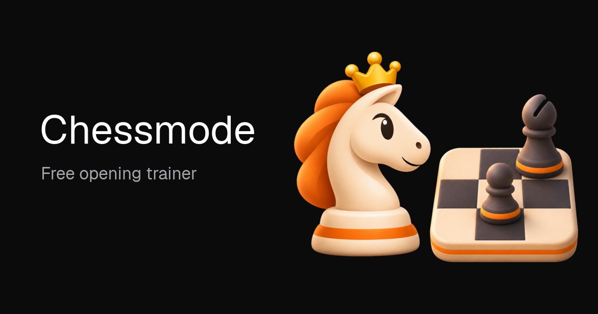

# Chessmode

Chessmode is a free, open-source chess opening trainer with full game review. It runs locally in your browser and keeps your progress on your device.



## Features

- Opening courses with Learn, Drill, Time, Arena, and Puzzles modes
- Spaced-repetition practice
- Import games and review them with Stockfish
- Offline PWA
- Android app via Capacitor

## Development

```sh
npm ci
npx vite dev
```

Run the checks:

```sh
npx svelte-check --tsconfig ./tsconfig.json
npx vitest run
npx vite build
npm run test:e2e
```

## Deploy

Deploy to Cloudflare Pages with build command `npx vite build` and output directory `build`. `static/_headers` sets COOP and COEP headers so multi-threaded Stockfish works.

## Courses

See [scripts/course-format.md](scripts/course-format.md) for the course format.

## License

GPL-3.0. See [LICENSE](LICENSE).
